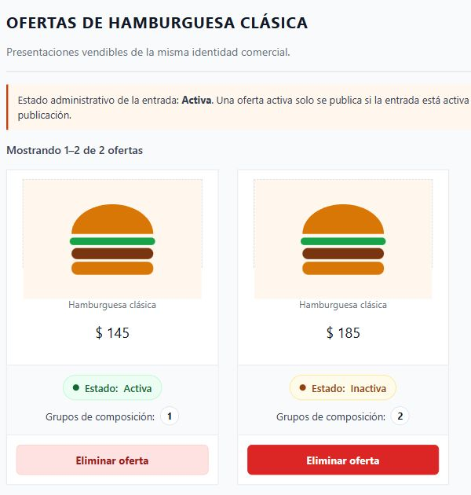
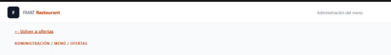
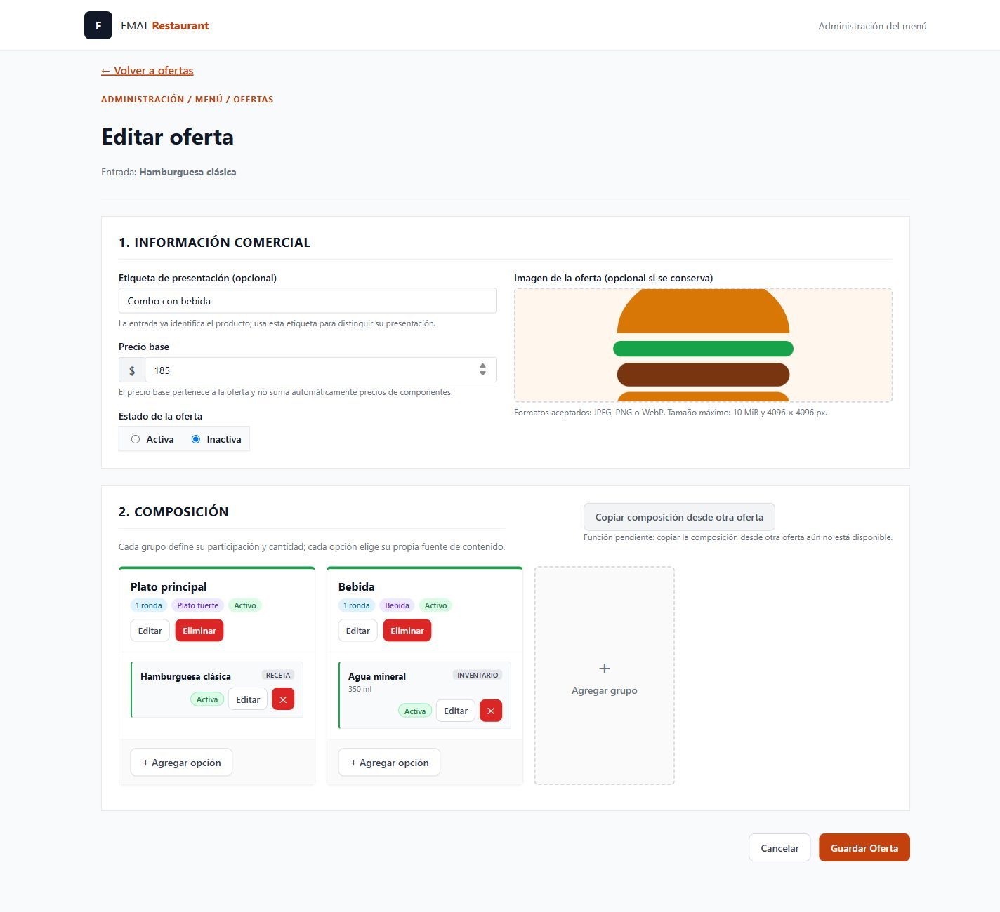

# Auditoría de UX, UI y diseño del administrador de menú

Fecha de revisión: 23 de octubre de 2026. Segunda revisión ampliada a cabeceras, overlays y capas modales. Estado: diagnóstico y recomendaciones, sin correcciones implementadas.

La referencia normativa de esta revisión es [DESIGN.md](../../../DESIGN.md), en su versión actual del directorio de trabajo. La revisión usa las pantallas reales del modo demo, sus datos temporales y la implementación que las presenta. No evalúa los mockups como si fueran el producto terminado.

## Resultado

El problema principal está en las tarjetas de ofertas. Sus imágenes exceden el contenedor y cubren los nombres de las presentaciones. En móvil también cubren el precio y el nombre de la entrada. El usuario debe abrir cada oferta para identificarla. La información existe en el DOM, pero no se puede leer en la tarjeta.

El resto del producto tiene una base aprovechable. Predominan los fondos neutros, el naranja principal coincide con `#C2410C` y los formularios conservan etiquetas visibles. Sin embargo, cada módulo aplica una jerarquía diferente. Cambian las cabeceras, los anchos, los tamaños de título, los radios y el tratamiento de las acciones. El editor de ofertas concentra las desviaciones visuales y de interacción.

La segunda revisión incorpora la imagen aportada por el usuario. La barra de marca de esa captura debe retirarse de las pantallas del módulo. También se confirmaron fondos redundantes en las eliminaciones, acumulación de diálogos y desplazamiento de la página detrás de una confirmación. El primer reporte describía la confirmación como una base válida, pero no había separado la utilidad de confirmar de los problemas de sus capas de fondo. Esta revisión conserva la confirmación y cuestiona las capas adicionales.

Se documentan 28 hallazgos: **1 P1, 24 P2 y 3 P3**. U05, U06, U16 y U17 se precisan con la segunda revisión. U26, U27 y U28 son nuevos. No se identificó un P0 en el recorrido realizado. Esta clasificación prioriza impacto observado, no cantidad de reglas incumplidas.

| Prioridad | Criterio usado |
| --- | --- |
| P1 | Oculta información necesaria para identificar una oferta y comprobar sus datos comerciales. Debe resolverse antes de dar por terminado el diseño. |
| P2 | Dificulta una tarea, reduce legibilidad o seguridad de uso, o rompe una pauta compartida con alcance visible. |
| P3 | Pulido visual o presentación de estados con menor impacto inmediato. |

## Método y alcance

### Entorno observado

- Se ejecutó `npm run dev:mock` en `http://127.0.0.1:5174`. El título de la pestaña comenzó con `[DEMO]`.
- Se inspeccionó la interfaz con el navegador integrado, capturas JPEG, árbol de accesibilidad y mediciones del DOM y de estilos calculados.
- Se usaron los datos de hamburguesa, limonada, brownie, categorías, recetas y ofertas incluidos en el repositorio demo.
- Se modificó temporalmente una oferta durante el recorrido para comprobar selección de receta, guardado y cambio de estado. Una navegación completa reinició los datos, como define la demo.
- Se revisaron el código de las pantallas y los estilos para explicar los defectos observados y localizar su alcance. No se cambiaron componentes, estilos, reglas de negocio ni tests.
- Se aplicó `ui-ux-pro-max` para revisar objetivos táctiles, validación, desplazamiento y confirmaciones. Se aplicó `unslop` al texto del reporte y al diagnóstico de la microcopia del producto.

El directorio de trabajo ya tenía cambios al iniciar. La revisión corresponde a ese estado, sobre la base Git `c73755d98de89f690756a5b179c69761c4934119`, y no exclusivamente a ese commit. En particular, se respetó el `DESIGN.md` modificado que estaba presente.

| Viewport solicitado | Uso en el recorrido |
| --- | --- |
| 1440 × 1000 | Catálogo, categorías, recetas, entrada, ofertas y composición en escritorio. |
| 1024 × 768 | Catálogo, formulario de receta, validación, alta de oferta, confirmación y error de carga. |
| 740 × 900 | Transición móvil del catálogo. |
| 600 × 900 | Tabla de insumos dentro del formulario de receta. |
| 390 × 844 | Entrada, ofertas, composición y diálogos anidados. |
| 320 × 800 | Catálogo, controles de filtrado y búsqueda sin resultados. |

Son pruebas de ancho responsive y teclado en Chromium, no pruebas en teléfonos, tabletas o terminales POS físicos. Algunas capturas excluyen la barra de desplazamiento nativa. Las medidas corresponden al DOM, no a una estimación sobre la imagen. Los breakpoints de `DESIGN.md` se interpretan según el ancho útil que ofrece el contenedor, no solo según el ancho exterior del navegador.

### Recorridos y resultados

| Recorrido | Comprobación realizada | Resultado relevante |
| --- | --- | --- |
| Catálogo | Búsqueda, filtros, navegación a edición y ofertas, estado sin coincidencias. | Funciona. La apertura de ofertas carece de una acción visible en la tarjeta y hay desviaciones en anchos intermedios. |
| Categorías | Apertura, cierre y envío vacío del formulario. | El campo vacío depende del aviso nativo del navegador. El botón de cierre mide 32 × 32 px. |
| Recetas | Apertura, envío vacío, insumos, búsqueda sin coincidencias y cierre con cambios. | Mensaje de error separado del campo, estado vacío contradictorio y descarte al cerrar. |
| Entrada | Formulario nuevo, envío vacío y ruta a una entrada inexistente. | La validación de identidad tiene resumen e indicación junto al campo. La carga inexistente ofrece reintentar indefinidamente. |
| Ofertas | Listado, edición, precio, estado y ausencia de ofertas. | Guardar y cambiar estado funcionan. La tarjeta oculta contenido comercial. El cambio de estado sí muestra confirmación. |
| Composición | Editar grupo, agregar opción, elegir receta y guardar. | Funciona. En móvil los grupos permanecen en una fila horizontal. |
| Selección de receta | Apertura desde una opción y asignación a la oferta. | La selección devuelve el foco a su disparador. El selector reutiliza demasiado contenido de la página de administración. |
| Eliminación | Apertura de confirmación de entrada archivada y cancelación. | Hay identificación de la entrada, foco inicial en Cancelar y acción destructiva diferenciada. No se confirmó la eliminación durante el recorrido manual. |
| Teclado | Foco de diálogos, cierre con Escape, cambio de imagen y transición de rutas. | Existen anillos de foco. La acción visual de cambiar imagen depende de hover y el cambio de ruta deja el foco en `BODY`. |

En la primera revisión se ejecutó la suite existente con `npm run test:e2e:demo`, usando el Chromium ya instalado mediante `PLAYWRIGHT_BROWSERS_PATH`. Resultado: **2 pruebas aprobadas en 5,9 segundos**. Estas pruebas cubren creación y edición de categorías y recetas, carga de imágenes, entradas, composición y cambios de estado. También comprueban que sus recorridos no llaman a `/api/` ni producen errores de JavaScript. El navegador integrado no registró avisos ni errores en la consulta de consola realizada al finalizar esa revisión.

La suite funcional aprobada no comprueba que un título se vea: una expectativa sobre un encabezado del DOM puede pasar aunque una imagen lo cubra.

### Límites

No se simularon caídas de Menu, Inventory o Media, latencia sostenida, respuestas HTTP de producción, conflictos entre usuarios ni expiración de recuperaciones. Los mensajes de recuperación avanzada se revisaron en código cuando se indican como evidencia estática. No se ejecutó un auditor automático de accesibilidad ni un lector de pantalla. Tampoco se verificaron Safari, Firefox, teclado virtual, zoom del sistema o integración dentro del shell anfitrión.

Las ilustraciones SVG de comida pertenecen al conjunto de datos demo. No se recomienda reemplazarlas como si fueran fotografías definitivas de producción. Sí se audita cómo la interfaz recorta, contiene y presenta cualquier imagen.

## Segunda revisión de cabeceras y capas

### La imagen adjunta y el espacio anterior a la tarea

La [imagen aportada](evidence/overlay-review/37-user-header-reference.png) muestra la marca "FMAT Restaurant", "Administración del menú", "Volver a ofertas" y el rótulo "Administración / Menú / Ofertas". Se reprodujo esa composición en el editor real de la demo.

La barra superior mide 72 px y tiene `position: static` y `z-index: auto`. En esa pantalla no había ningún diálogo abierto ni `.dialog-backdrop`. Por tanto, el recorte identifica una cabecera global innecesaria dentro del módulo; no prueba que haya una máscara modal permanente. El defecto visual sigue siendo concreto: la pantalla gasta una franja completa en marca y sección globales, vuelve a ofrecer contexto en filas separadas y recién inicia el H1 cerca de los 171 px de altura. La primera sección del formulario comienza alrededor de los 308 px.

La recomendación de U05 se hace explícita: retirar la marca y su barra de las pantallas de contenido. La cabecera local debe reunir regreso, título y el contexto de entrada que sí ayuda a editar. La demo puede tener un montaje propio, pero no debe servir como razón para conservar una cabecera global en cada módulo. Cambiar el color o agregar otra banda no resolvería el problema de responsabilidad y espacio.

### Inventario de capas comprobadas

| Elemento y recorrido | Evidencia actual | Decisión de diseño recomendada |
| --- | --- | --- |
| Barra de marca en catálogo y ofertas | `.global-nav` estática de 72 px. Cero diálogos y fondos en la pantalla normal. | Retirar de las pantallas del módulo. Mantener navegación local de la tarea. U05 y U06. |
| Confirmación de eliminar entrada, oferta o receta | Wrapper fijo con fondo `rgba(17,24,39,0.45)` más `dialog:modal::backdrop` nativo `rgba(0,0,0,0.1)`. Ambos presentes en los tres recorridos. | Conservar la confirmación con un único mecanismo de fondo. Retirar la capa redundante. U26. |
| Formulario de categoría | Un diálogo modal con fondo `rgba(17,24,39,0.6)`, sin wrapper adicional. | Su utilidad es local. Unificar intensidad, geometría y controles; no añadir otra máscara. U03, U08 y U26. |
| Formulario de receta | Un fondo propio de 60 %. En el flujo anidado se suma a los fondos de las tareas anteriores. | Usarlo como edición local o paso del mismo flujo, con un solo nivel de bloqueo visible. U16 y U27. |
| Grupo u opción | Fondo negro de 65 %, más oscuro que el ejemplo de confirmación de la guía. | Acordar un tratamiento de fondo común y proporcionado. La edición no necesita una máscara de distinta familia visual. |
| Opción, biblioteca y nueva receta | Se comprobaron tres `dialog[open]:modal` simultáneos con fondos de 65 %, 60 % y 60 %. | Sustituir la cadena de ventanas por pasos dentro de una misma tarea o por edición local. U27. |
| Cambiar imagen | Overlay absoluto limitado a la vista previa y visible solo con hover. | Mostrar una acción legible con teclado y tacto. No convertirlo en una capa de pantalla completa. U23. |
| Enlace de tarjeta de entrada | Enlace absoluto sobre la tarjeta, con acciones encima mediante `z-index`. | Hacer visible el destino de ofertas. No tratar este enlace como una máscara modal global. U11. |
| Selector de categorías de entrada | Panel en flujo normal, `position: static`, sin diálogo ni fondo. | Conservar el patrón local; no convertirlo en modal. |
| Acciones de entrada | Footer `position: sticky`, `z-index: 5`, limitado al formulario. | Mantenerlo solo si aporta acceso y no tapa controles. No añadir una capa global de guardado. U17. |
| Carga de rutas | Fallback de contenido, sin una máscara fija definida en `App`. | Definir carga local estable sin inventar un bloqueo de toda la aplicación. U25. |

Las capturas nuevas y las lecturas de estilos están en [overlay-measurements.json](evidence/overlay-review/overlay-measurements.json). Las opacidades anteriores son las de cada capa, no una medición del color final de un píxel. Con fondos superpuestos, el oscurecimiento se acumula; el resultado visible depende también del área cubierta por los diálogos.

### Comportamientos que sí se conservaron

Escape cerró primero la receta nueva y dejó abiertos biblioteca y opción. Otro Escape cerró la biblioteca y devolvió el foco a "Elegir receta". El siguiente cerró la opción. Al terminar quedaron cero diálogos y cero wrappers. Las confirmaciones canceladas de entrada, oferta y receta también se retiraron. No se observó un fondo huérfano persistente en estos recorridos.

La nueva revisión tampoco confirmó un bloqueo modal roto por teclado. El problema verificado es la acumulación visual y de tareas, más el desplazamiento del documento detrás de una confirmación. Separar esos problemas evita sustituir una cadena de ventanas por otro overlay global que mantenga la misma fricción.

### Alcance dentro del anfitrión

En la demo, los fondos nativos y los wrappers de confirmación cubren todo el viewport de su documento. No se inspeccionó el shell real ni se conoce por esta prueba si el módulo se monta en DOM compartido, iframe u otro aislamiento. Debe probarse el área real de bloqueo antes de integrar.

La revisión estática también localizó reglas de `:root`, `body`, `*`, `a`, `button` y clases genéricas de modal en los estilos cargados por el frontend. Si el montaje comparte documento con el shell, esas reglas deben limitarse al ámbito del módulo o ser propiedad del anfitrión. El posible efecto sobre otros módulos queda pendiente de una prueba de integración; no se presenta como una fuga visual ya reproducida.

## Diferencias frente al sistema de diseño

| Área | Lo observado | Pauta y dirección requerida |
| --- | --- | --- |
| Cabeceras | Catálogo con marca blanca; categorías y recetas con banda oscura; ofertas con título en mayúsculas; edición de oferta con tamaño nativo de H1. | Alcance del documento y §§1, 3 y 4.4. Cabecera local consistente, subordinada al shell y a la tarea. |
| Tipografía | Títulos principales de 20, 24, 28 y 32 px; metadatos de opciones de 10 y 11 px. | §3. H1 de 28/36, H2 de 22/30, H3 de 18/26 y captions de 12/16, según el papel del texto. |
| Formularios | Entradas y categorías con controles de 8 px de radio; ofertas con controles de 4 px y alturas menores. | §§4.2 y 5. Radio de control de 8 px, altura estándar de 40 px y variante táctil de 48 px. |
| Contenedores | Tarjetas de entrada de 12 px; ofertas rectangulares; grupos de 6 px; varios niveles de cajas para una misma tarea. | §§4.3 y 5. Contenedor principal de 12 px y agrupación por contenido. |
| Estados | Puntos con texto, píldoras, texto sin insignia, franjas laterales y superiores, radios azules del navegador. | §§2, 4.2 y 7. Estado explícito con tratamiento común; sin franjas laterales en tarjetas. |
| Acciones | Eliminar domina las tarjetas de oferta y receta. Abrir ofertas no tiene una etiqueta visible en entradas. | §§4.1 y 4.5. Jerarquía según la tarea y acciones secundarias agrupadas. |
| Móvil | Composición horizontal, controles pequeños y transformaciones a 520 o 700 px. | §§5 y 6. Columna apilada según ancho útil y controles aptos para tacto. |
| Texto | `INACTIVE`, `slot`, borrador local, servidor y explicaciones repetidas de implementación. | Principios de claridad y §4.1. Explicar la consecuencia y la acción con términos del restaurante. |

## Índice de hallazgos

| ID | Prioridad | Cambio requerido |
| --- | --- | --- |
| U01 | P1 | Contener las imágenes de ofertas para que nombre y precio permanezcan visibles. |
| U02 | P2 | Apilar los grupos de composición en móvil. |
| U03 | P2 | Corregir alturas y áreas de interacción pequeñas. |
| U04 | P2 | Unificar validación visible, mensajes por campo y asociación accesible. |
| U05 | P2 | Delimitar la marca y navegación global que corresponden al shell. |
| U06 | P2 | Unificar cabeceras locales, anchos y densidad de estructura. |
| U07 | P2 | Recuperar la escala tipográfica y la legibilidad de metadatos. |
| U08 | P2 | Aplicar radios, espaciado y contenedores compartidos. |
| U09 | P2 | Retirar franjas laterales y normalizar los estados. |
| U10 | P2 | Reducir el protagonismo de eliminar y explicar acciones restringidas. |
| U11 | P2 | Hacer visible la acción para consultar ofertas desde una entrada. |
| U12 | P2 | Presentar importes con formato, peso y alineación consistentes. |
| U13 | P2 | Separar biblioteca vacía de búsqueda sin coincidencias. |
| U14 | P2 | Ofrecer salida útil ante una entrada inexistente. |
| U15 | P2 | Proteger los cambios al abandonar un formulario. |
| U16 | P2 | Adaptar el selector de recetas a la tarea de asignación. |
| U17 | P2 | Mantener el guardado de ofertas accesible en formularios largos. |
| U18 | P2 | Confirmar el guardado al regresar al listado. |
| U19 | P2 | Alinear los cambios responsive con el ancho disponible. |
| U20 | P2 | Reescribir microcopia técnica, repetida o ambigua. |
| U21 | P3 | Retirar del flujo principal los controles de funciones pendientes. |
| U22 | P3 | Sustituir emojis y glifos por iconos consistentes. |
| U23 | P2 | Mostrar la acción de cambiar imagen sin depender de hover. |
| U24 | P2 | Gestionar el contexto y el foco al cambiar de ruta. |
| U25 | P3 | Definir esqueletos de carga y conservar la estructura durante la espera. |
| U26 | P2 | Eliminar el doble fondo de las confirmaciones y unificar su tratamiento. |
| U27 | P2 | Evitar la cadena de tres diálogos con fondos acumulados. |
| U28 | P2 | Mantener inmóvil el documento detrás de una confirmación modal. |

## Hallazgos detallados

### U01. P1. Las imágenes de las ofertas tapan nombres y precios

En escritorio, las tarjetas de "Individual" y "Combo con bebida" muestran la misma hamburguesa y el nombre de la entrada. Los nombres de las presentaciones quedan cubiertos. En 390 px, la imagen también invade la zona del precio. Dos ofertas distintas terminan siendo visualmente indistinguibles.

Para reproducir, abrir el catálogo demo, entrar en las ofertas de "Hamburguesa clásica" y observar las dos tarjetas a 1440 y 390 px. En escritorio, la caja de imagen mide 112 px de alto, pero el elemento `img` mide aproximadamente 151,2 px. El encabezado ocupa la franja vertical entre 502,4 y 524,4 px, y la imagen llega hasta 530,4 px. La consulta del elemento situado sobre el centro del título devuelve `IMG`.

Debe definirse una zona de imagen que contenga su contenido y reserve espacio independiente para título, entrada y precio. El recorte no debe depender de la relación de aspecto del archivo ni del mínimo intrínseco de una imagen dentro de grid.

Se acepta cuando "Individual", "Combo con bebida" y sus importes se leen completos en ambas anchuras y ninguna imagen invade texto. La comprobación futura debe incluir imágenes apaisadas, verticales y cuadradas.

La pauta afectada es `DESIGN.md` §§3, 4.3 y 6. Evidencia: [escritorio](evidence/11-offers-desktop.jpg), [móvil](evidence/17-offers-mobile-after-save.jpg) y [mediciones](evidence/measurements.json). Referencias: [OfferCard.tsx](../../../../src/features/offers/OfferCard.tsx), línea 23, y [estilos de ofertas](../../../../src/features/offers/styles.css), líneas 95 y 106.

### U02. P2. La composición mantiene una fila horizontal en móvil

El editor conserva grupos de ancho mínimo de 280 px en una fila desplazable. A 390 px, el contenedor tiene unos 349 px útiles y 792 px de contenido. Solo se ve el primer grupo completo y una parte del siguiente. El botón "Agregar grupo" queda más lejos dentro de la misma fila.

Para reproducir, editar "Combo con bebida" y bajar a "Composición" en 390 px. Revisar el grupo "Bebida" y el acceso a agregar otro grupo exige desplazamiento lateral además del vertical de la página.

Debe existir una variante apilada para ancho móvil. Cada grupo debe ocupar el ancho útil y conservar sus opciones y acciones dentro de él. El desplazamiento lateral puede estudiarse para un espacio de trabajo amplio, pero no debe ser el mecanismo necesario para descubrir grupos en móvil.

Se acepta cuando todos los grupos y "Agregar grupo" aparecen mediante el recorrido vertical y cada grupo cabe sin recorte. La pauta es `DESIGN.md` §6. Evidencia: [composición móvil](evidence/13-offer-edit-mobile.jpg). Referencia: [estilos de ofertas](../../../../src/features/offers/styles.css), líneas 504 y 547.

### U03. P2. Varias áreas de interacción quedan por debajo de los tamaños del proyecto

Los botones generales aumentan de tamaño en algunos breakpoints, pero hay controles que no usan esa variante. Las medidas observadas incluyen cierre de categoría y receta de 32 × 32 px, cierre de grupo de unos 22,7 × 32 px, estado de opción de unos 48,2 × 20 px e inputs comerciales de oferta de 36 px de alto. En 320 px, las acciones superiores del catálogo bajan a 36 px. El buscador de insumos mide aproximadamente 26,8 px de alto y las cantidades de insumos, 31,2 px.

Debe definirse una variante táctil compartida para botones, selects, campos, controles de estado y cierres. Los iconos pueden conservar su tamaño visual dentro de una zona de interacción mayor. Deben revisarse también las etiquetas clicables de los radios, no solo el círculo nativo de 13 px.

Se acepta cuando se cumplen los tamaños de §§4.1, 4.2 y 5 de `DESIGN.md`: controles estándar de 40 px, iconos con mínimo de 40 × 40 px y variante táctil de 48 px. El objetivo táctil general debe contemplar al menos 44 px, según la lista de entrega del documento. Estos son umbrales del proyecto; la medición por sí sola no acredita una infracción normativa de accesibilidad.

Evidencia: [receta móvil](evidence/07-recipe-dialog-mobile.jpg), [grupo](evidence/14-slot-dialog-mobile.jpg), [catálogo estrecho](evidence/18-catalog-mobile-320.jpg) y `controls` en [mediciones](evidence/measurements.json). Referencias: [estilos de categorías](../../../../src/features/categories/styles.css), línea 91; [recetas](../../../../src/features/recipes/styles.css), líneas 133 y 229; [ofertas](../../../../src/features/offers/styles.css), líneas 711 y 789; [catálogo](../../../../src/features/catalog/styles.css), línea 351.

### U04. P2. Categorías y recetas no ofrecen la misma validación que entradas

Al guardar una categoría vacía aparece "Completa este campo" en el aviso nativo del navegador. No hay un mensaje persistente debajo de Nombre. En recetas, el mensaje "Indica el nombre de la receta" aparece después de toda la sección de insumos. En la prueba de tableta quedó debajo de la parte visible del área desplazable. El foco volvió a Nombre, pero el campo no tuvo `aria-invalid` ni una asociación mediante `aria-describedby` con ese error.

La entrada nueva ya tiene un patrón mejor: resumen enfocable, campo marcado y mensaje junto a él. Debe usarse como referencia para acordar un comportamiento común. Los errores de nombre, instrucciones, selección de insumo y cantidad necesitan su ubicación correspondiente. El resumen puede complementar los mensajes, sin reemplazarlos.

Se acepta cuando un envío inválido muestra el motivo junto al campo, lo asocia de forma accesible y permite llegar al error con teclado. Los campos obligatorios deben distinguirse de los opcionales antes del primer envío. No debe dependerse exclusivamente de una burbuja del navegador.

Pautas: `DESIGN.md` §4.2 y guía de validación de `ui-ux-pro-max`. Evidencia: [categoría vacía](evidence/04-category-validation.jpg), [receta inválida](evidence/22-recipe-validation-tablet.jpg) y [patrón de entrada que conviene conservar](evidence/09-entry-validation-mobile.jpg). Referencias: [CategoryFormDialog.tsx](../../../../src/features/categories/CategoryFormDialog.tsx), línea 584; [RecipeFormDialog.tsx](../../../../src/features/recipes/RecipeFormDialog.tsx), líneas 951 y 1153; [EntryFormPage.tsx](../../../../src/features/entries/EntryFormPage.tsx), línea 50.

### U05. P2. Las pantallas recrean funciones visuales que el documento asigna al shell

Catálogo, formularios de entrada, listado de ofertas, formulario de oferta y página no encontrada construyen su propia navegación con marca "FMAT Restaurant" y el texto "Administración del menú". El enlace de marca tampoco tiene un destino constante: en el catálogo lleva a `/`, mientras que en el editor de oferta lleva al listado de ofertas de esa entrada.

Debe retirarse `.global-nav` y su marca de las pantallas del módulo. La barra de la imagen adjunta no participa en editar una oferta y consume 72 px antes del contexto local. La marca y la navegación global corresponden al anfitrión. Si el montaje autónomo de demo necesita ese marco, debe proporcionarlo una sola vez fuera de las pantallas. Los módulos conservan sus títulos, botones de regreso, filtros y navegación local. La cabecera local de una tarea no debe eliminarse por su posición, sino simplificarse según su función.

Se acepta cuando catálogo, alta y edición de entrada, ofertas y página no encontrada no recrean la marca dentro de su contenido. La demo debe permitir revisar esa composición sin exigir otra barra global. Cualquier marco autónomo queda fuera de las pantallas y tiene un destino de marca predecible. La integración real con el shell queda pendiente de validación.

Pautas: alcance de `DESIGN.md` y §7. Evidencia: [referencia del usuario](evidence/overlay-review/37-user-header-reference.png), [reproducción en demo](evidence/overlay-review/31-global-header-reproduced.jpg), [catálogo](evidence/01-catalog-desktop.jpg), [entrada](evidence/10-entry-new-desktop.jpg) y [ofertas](evidence/11-offers-desktop.jpg). Referencias: [CatalogPage.tsx](../../../../src/features/catalog/CatalogPage.tsx), línea 353; [EntryFormPage.tsx](../../../../src/features/entries/EntryFormPage.tsx), línea 110; [OffersPage.tsx](../../../../src/features/offers/OffersPage.tsx), línea 647; [OfferFormPage.tsx](../../../../src/features/offers/OfferFormPage.tsx), línea 1138; [App.tsx](../../../../src/App.tsx), línea 29.

### U06. P2. Las cabeceras y los contenedores cambian de lenguaje entre módulos

El catálogo usa un contenido de hasta 1200 px y una cabecera compacta. Categorías y recetas usan una banda oscura de unos 146 px de alto, un contenido de hasta 1040 px y un panel exterior que vuelve a titular la colección. Entradas usa hasta 1040 px y ofertas hasta 1152 px. La sensación de cambio de aplicación ocurre al pasar de una tarea a otra dentro del mismo menú.

Debe acordarse una cabecera local común con regreso, título, contexto necesario y acciones. En el editor de ofertas, el regreso, el rótulo "Administración / Menú / Ofertas", el H1 y el nombre de la entrada consumen filas separadas; debe compactarse esa estructura después de retirar la marca global de U05. El rótulo es texto repetido, no un breadcrumb interactivo que justifique otra fila. El canvas debe continuar dentro de la misma familia de superficies. Categorías y recetas pueden conservar estructuras de lista distintas, pero la banda oscura, el margen superior y la repetición del título necesitan una razón de tarea. En el selector de recetas, esa repetición debe reducirse aún más, según U16.

Se acepta cuando la alineación del título, el primer control y el contenido es consistente al recorrer catálogo, categorías, recetas y ofertas. Los anchos distintos deben justificarse por el contenido, no por estilos independientes. El equilibrio 70/20/10 se usa como guía de jerarquía; no se afirma una medición de porcentajes de píxeles.

Pautas: `DESIGN.md` §§1, 4.4 y 5. Evidencia: [categorías](evidence/02-categories-desktop.jpg), [recetas](evidence/05-recipes-desktop.jpg) y [entrada](evidence/10-entry-new-desktop.jpg). Referencia: [estilos compartidos](../../../../src/shared/primitives.css), líneas 136, 171 y 176, y contenedores en los estilos de cada módulo.

### U07. P2. La escala tipográfica no se mantiene entre pantallas

El H1 del catálogo usa 28/36 px. Categorías y recetas usan 24/32 px. Entradas también usa 24/32 px. El listado de ofertas usa 20/28 px y mayúsculas. El H1 del editor de ofertas conserva el tamaño nativo de 32 px. Los títulos de categoría, receta y grupo usan 16 px, mientras que el sistema establece 18/26 px para títulos de componentes. La fuente del contenido de opciones baja a 10 y 11 px para origen, cantidad e insignias.

Debe asignarse cada papel de texto a la escala documentada. Los títulos de tarea deben compartir jerarquía y los encabezados de secciones no deben depender del estilo predeterminado del navegador. El origen de una opción y su cantidad son información operativa, no texto legal que pueda reducirse para encajar.

Se acepta cuando los títulos equivalentes tienen el mismo tamaño, altura de línea y peso; los metadatos no bajan de 12/16 px; y el contenido principal mantiene la legibilidad de la escala de 16/24 px. Deben retirarse las mayúsculas y el espaciado entre letras que se aplican a títulos completos de ofertas y diálogos.

Pauta: `DESIGN.md` §3. Evidencia: [catálogo](evidence/01-catalog-desktop.jpg), [ofertas](evidence/11-offers-desktop.jpg), [composición](evidence/12-offer-edit-desktop.jpg) y [diálogo de opción](evidence/15-option-dialog-mobile.jpg). Referencias: [estilos compartidos](../../../../src/shared/primitives.css), línea 150; [entradas](../../../../src/features/entries/styles.css), línea 41; [ofertas](../../../../src/features/offers/styles.css), líneas 22, 317, 576, 687 y 781.

### U08. P2. Radios y espaciados producen componentes de familias distintas

Las tarjetas de catálogo tienen radio de 12 px, las de ofertas no tienen radio y los grupos de composición usan 6 px. El formulario de entrada usa 8 px como contenedor. Los controles compartidos de ofertas usan 4 px de radio, frente a 8 px en categorías y entradas. Aparecen gaps de 6 y 10 px y paddings de 14 y 18 px fuera de la escala de base 4 px.

Debe aplicarse la jerarquía existente: 4 px para insignias, 8 px para controles y 12 px para tarjetas, paneles y diálogos. Debe reducirse la variación de espaciado sin sumar contenedores adicionales. En recetas, el panel exterior, la tarjeta y la caja de insumos no necesitan tener todos el mismo grado de borde y separación.

Se acepta cuando las variantes de un componente conservan radio, alto, espaciado y elevación aunque se carguen desde rutas diferentes. Las excepciones deben quedar documentadas por una necesidad de contenido.

Pautas: `DESIGN.md` §§4.1, 4.2, 4.3 y 5. Evidencia: [recetas](evidence/05-recipes-desktop.jpg), [ofertas](evidence/11-offers-desktop.jpg) y [editor](evidence/12-offer-edit-desktop.jpg). Referencias: [estilos globales](../../../../src/styles.css), línea 289; [ofertas](../../../../src/features/offers/styles.css), líneas 67, 308, 547 y 734; [entradas](../../../../src/features/entries/styles.css), línea 54.

### U09. P2. Los estados usan franjas y tratamientos inconsistentes

Las opciones activas e inactivas tienen una franja lateral verde o ámbar. Los grupos suman una franja superior y varias píldoras. El estado de oferta es una píldora clicable, el de entrada es una insignia con punto y texto, y una oferta nueva muestra "Inactiva" como texto sin el tratamiento común. Los radios de oferta conservan el azul del navegador. El tipo de tiempo usa violeta y las rondas usan azul, aunque no son estados informativos.

Debe retirarse la franja lateral de las opciones, prohibida por `DESIGN.md`. Debe definirse un tratamiento de estado con punto y texto legible, separado del control que lo modifica. El tipo de tiempo y la cantidad pueden usar texto o etiquetas neutras. La selección de radios debe usar el terracota documentado. Las franjas superiores no están prohibidas expresamente, pero duplican el estado ya escrito y conviene eliminarlas para reducir señales competidoras.

Se acepta cuando el usuario reconoce el mismo estado en tarjeta, formulario y opción, y la información sigue siendo comprensible sin distinguir colores. Las insignias deben seguir el radio de 4 px. La prohibición de botones primarios en forma de píldora no se usa como argumento contra las píldoras de estado; aquí el problema es su inconsistencia con la geometría prescrita para insignias.

Pautas: `DESIGN.md` §§2, 4.2, 5 y 7. Evidencia: [composición](evidence/12-offer-edit-desktop.jpg), [alta de oferta](evidence/25-offer-new-tablet.jpg). Referencias: [estilos de ofertas](../../../../src/features/offers/styles.css), líneas 559, 589, 665 y 711; [OfferCommercialInfo.tsx](../../../../src/features/offers/OfferCommercialInfo.tsx), línea 123.

### U10. P2. Eliminar tiene más protagonismo del necesario

Las tarjetas de ofertas terminan con un botón rojo de ancho completo. Las recetas repiten un botón rojo por fila y la composición acumula eliminar grupo y eliminar opción junto a las acciones de edición. En entradas activas aparece un botón deshabilitado que ocupa la mitad de la fila de acciones. Su explicación está en `title`, útil con ratón pero poco accesible al uso táctil. La oferta activa no explica junto al botón por qué no puede eliminarse.

Debe mantenerse el rojo para confirmar una acción destructiva, pero las acciones secundarias deben agruparse en un menú contextual o en un nivel visual menor. Debe explicarse la condición de eliminación cuando la acción esté restringida. No debe obligarse al usuario a interpretar el color de un botón deshabilitado. La confirmación actual de entrada es una base válida y no debe perderse.

Se acepta cuando consultar o editar es más visible que eliminar, las restricciones se pueden conocer con teclado y tacto, y toda eliminación persistente conserva identificación y confirmación. Quitar una opción del borrador debe distinguirse de eliminar una entidad del catálogo; no requiere la misma advertencia si existe una reversión clara.

Pautas: `DESIGN.md` §§4.1, 4.5 y 4.6. Evidencia: [ofertas](evidence/11-offers-desktop.jpg), [recetas](evidence/05-recipes-desktop.jpg), [composición](evidence/12-offer-edit-desktop.jpg) y [confirmación que se conserva](evidence/26-delete-confirmation-tablet.jpg). Referencias: [OfferCard.tsx](../../../../src/features/offers/OfferCard.tsx), línea 49; [EntryCard.tsx](../../../../src/features/catalog/EntryCard.tsx); [SlotCard.tsx](../../../../src/features/offers/SlotCard.tsx); [SlotOptionItem.tsx](../../../../src/features/offers/SlotOptionItem.tsx).

### U11. P2. La tarjeta de entrada no anuncia visualmente que abre las ofertas

La tarjeta completa tiene un enlace superpuesto con el nombre accesible "Ver ofertas de Hamburguesa clásica", pero sus únicas acciones visibles son "Editar" y "Eliminar". El número "Ofertas: 2" parece metadato y el título no tiene tratamiento de enlace. Para una persona que usa tacto, el cursor no ayuda a descubrir el comportamiento.

Debe mostrarse una acción inequívoca para abrir las ofertas, mediante el título enlazado o una etiqueta "Ver ofertas" junto al conteo. Editar y eliminar pueden agruparse para evitar añadir una tercera fila de botones. El precio pertenece a las ofertas, por lo que no corresponde inventar un precio único en la entrada para imitar el ejemplo genérico de tarjeta de producto de la guía.

Se acepta cuando el usuario identifica antes de tocar qué acción abre las presentaciones y qué acción edita la identidad comercial. La misma distinción debe existir en la secuencia de teclado.

Pautas: `DESIGN.md` §§4.3 y 4.4. Evidencia: [catálogo](evidence/01-catalog-desktop.jpg). Referencias: [EntryCard.tsx](../../../../src/features/catalog/EntryCard.tsx) y [estilos de catálogo](../../../../src/features/catalog/styles.css), líneas 129 y 230.

### U12. P2. Los importes no tienen el tratamiento financiero documentado

Los precios se construyen como `$ ` más el número y se presentan como `$ 145` o `$ 195`. El precio de tarjeta tiene peso normal y alineación centrada. Además del defecto de solapamiento de U01, esto dificulta comparar ofertas y no sigue el tratamiento de importes de la guía.

Debe acordarse el formato monetario de la aplicación con moneda y localización explícitas, conservar decimales cuando correspondan y alinear los importes a la derecha con peso semibold o bold. El campo de precio debe mantener su etiqueta y aclarar la moneda sin depender solo del símbolo `$`.

Se acepta cuando importes enteros, fraccionarios y de varios dígitos comparten el mismo formato, sin saltos o recortes, y los listados permiten compararlos. No se prescribe redondear o cambiar los valores almacenados como parte de una corrección visual.

Pauta: `DESIGN.md` §§3 y 4.5. Evidencia: [ofertas de escritorio](evidence/11-offers-desktop.jpg) y [mediciones del precio](evidence/measurements.json). Referencias: [OfferCard.tsx](../../../../src/features/offers/OfferCard.tsx), línea 42; [estilos de ofertas](../../../../src/features/offers/styles.css), línea 124; [OfferCommercialInfo.tsx](../../../../src/features/offers/OfferCommercialInfo.tsx), línea 100.

### U13. P2. La búsqueda sin coincidencias afirma que no existen recetas

Buscar `sin-coincidencias-auditoria` en una biblioteca que contiene tres recetas muestra el título "Aún no hay recetas registradas". Debajo indica que no se encontraron recetas para el término. La acción destacada es "Crear receta", aunque el usuario necesita recuperar los resultados existentes.

Debe distinguirse una biblioteca sin datos de una búsqueda sin resultados. El segundo caso debe identificar la búsqueda y ofrecer limpiar o cambiar la consulta como acción principal de recuperación. Crear puede permanecer como acción secundaria si tiene sentido para la tarea.

Se acepta cuando una búsqueda fallida nunca afirma que el catálogo está vacío y se puede volver a las recetas existentes con una acción visible. Debe aplicarse el mismo criterio al selector de recetas anidado.

Pauta: `DESIGN.md` §4.6. Evidencia: [estado vacío contradictorio](evidence/23-recipe-empty-search.jpg). Referencia: [RecipePage.tsx](../../../../src/features/recipes/RecipePage.tsx), línea 382.

### U14. P2. La entrada inexistente conserva un formulario completo y un reintento sin salida contextual

Abrir `/entries/audit-missing-entry/edit` muestra "La entrada no existe en esta sesión demo" y "Reintentar entrada". El formulario sigue visible y deshabilitado, con textos de alta como "Imagen obligatoria para la nueva entrada", aunque la pantalla dice "Editar entrada". La demo entrega un error con estado 404 para este caso.

Debe diferenciarse recurso inexistente de fallo temporal. Para el primero, la pantalla debe explicar que no puede editarse y ofrecer volver al catálogo o actualizar la lista. El formulario vacío deshabilitado y los consejos de creación no aportan una acción útil. Para una falla temporal sí puede conservarse un reintento, junto con cualquier información ya cargada.

Se acepta cuando el caso 404 tiene una salida contextual y no invita a repetir una operación que no cambia el resultado. La misma presentación debe verificarse con el contrato HTTP real antes de cerrar el hallazgo.

Pauta: `DESIGN.md` §4.6. Evidencia: [entrada inexistente](evidence/27-missing-entry.jpg). Referencias: [EntryFormPage.tsx](../../../../src/features/entries/EntryFormPage.tsx), línea 123; [useEntryResources.ts](../../../../src/features/entries/useEntryResources.ts), línea 33; [repositorio demo](../../../../src/demo/repository.ts), línea 24.

### U15. P2. Escape descarta cambios de receta sin avisar

Se abrió una receta nueva, se escribió "Receta sin guardar de auditoría" en Nombre y se pulsó Escape. El diálogo cerró sin advertencia. Al abrirlo de nuevo, Nombre estaba vacío. El cierre voluntario llama a abandonar el flujo, por lo que no debe confundirse la recuperación de un envío pendiente con protección del texto que se estaba escribiendo.

Debe distinguirse un formulario intacto de uno modificado. Cuando haya cambios, el cierre por Escape, cruz, cancelar o navegación debe ofrecer continuar editando o descartar, o conservar un borrador recuperable con una explicación clara. La misma regla debe acordarse para categorías, entradas, ofertas y sus formularios secundarios. El descarte se reprodujo directamente en receta; los otros flujos requieren su comprobación individual.

Se acepta cuando el recorrido descrito no pierde los datos sin una decisión explícita y un formulario sin cambios sigue cerrando sin fricción. No debe alterarse el tratamiento de operaciones ya enviadas ni repetirse una escritura de forma automática.

Pautas: claridad y feedback de `DESIGN.md` §§1 y 4.6. Evidencia del valor reabierto en [mediciones](evidence/measurements.json), clave `unsavedRecipe`. Referencias: [RecipeFormDialog.tsx](../../../../src/features/recipes/RecipeFormDialog.tsx), líneas 641 y 929; [CategoryFormDialog.tsx](../../../../src/features/categories/CategoryFormDialog.tsx), línea 303; [OfferFormPage.tsx](../../../../src/features/offers/OfferFormPage.tsx), línea 1044.

### U16. P2. El selector de recetas reutiliza demasiada estructura de administración

Elegir receta desde una opción abre otro diálogo con una banda oscura, "Administración del menú", el título "Biblioteca de recetas", una descripción, Cancelar, el panel "Recetas disponibles", otra descripción, "Nueva receta" y el buscador. En 390 px, la primera receta comienza cerca de la mitad inferior del diálogo. Crear una receta puede añadir un tercer diálogo a esta secuencia.

Debe existir una presentación de selección que reutilice datos y tarjetas sin cargar toda la estructura visual de la página administrativa. Basta con una cabecera de tarea, búsqueda, resultados y acciones de asignación. La selección puede ser un paso que reemplace el contenido del editor de opción o una sección local, conservando su borrador. Crear receta debe conservarse si forma parte del flujo, con menor jerarquía que elegir una existente y sin abrir una tercera ventana modal. U27 documenta las tres capas que esta segunda revisión confirmó. No se recomienda eliminar la selección ni romper su regreso al formulario de opción.

Se acepta cuando el usuario ve búsqueda y al menos el primer resultado sin recorrer dos cabeceras y un panel exterior. El título debe decir qué se está eligiendo para qué grupo. Deben conservarse foco contenido, regreso al disparador y cierre exclusivo del diálogo superior. La asignación sí devolvió el foco al disparador durante esta auditoría.

Pautas: `DESIGN.md` §§1, 4.4 y 4.6. Evidencia: [selector móvil](evidence/16-recipe-picker-mobile.jpg). Referencias: [OfferFormPage.tsx](../../../../src/features/offers/OfferFormPage.tsx), línea 1350; [RecipePage.tsx](../../../../src/features/recipes/RecipePage.tsx), línea 310; [estilos compartidos](../../../../src/shared/primitives.css), línea 136.

### U17. P2. El guardado de oferta queda alejado de los datos en móvil

En el combo, la fila "Cancelar / Guardar Oferta" aparece al final de la página. En 390 × 844, su posición en el documento empieza aproximadamente a 1554 px. El formulario de entrada ya tiene una barra persistente de acciones, pero el de oferta exige volver al final tras revisar el precio o editar un grupo.

Debe acordarse una zona de acciones accesible para formularios largos. Primero deben compactarse la cabecera y los controles que no sirven a la tarea. Una barra persistente solo se justifica si sigue existiendo una necesidad de acceso durante el recorrido. En ese caso, debe limitarse al formulario y reservar espacio para no cubrir controles, mensajes o el último grupo. No debe convertirse en un overlay global ni añadirse por defecto a formularios cortos. Debe verse una sola acción principal de guardado y su texto debe usar la misma capitalización que el resto del producto.

Se acepta cuando guardar está disponible durante la revisión del formulario en móvil y al tabular nunca queda un campo completamente tapado por la barra. Deben comprobarse alturas bajas y teclado virtual en dispositivo antes de dar por validada la variante táctil.

Pautas: `DESIGN.md` §§4.1, 5 y 6. Evidencia: [oferta móvil](evidence/13-offer-edit-mobile.jpg) y posición `footer` en [mediciones](evidence/measurements.json). Referencias: [estilos de ofertas](../../../../src/features/offers/styles.css), línea 939; [estilos de entradas](../../../../src/features/entries/styles.css), línea 449.

### U18. P2. Guardar una oferta regresa al listado sin confirmación visible

Se agregó una opción y se cambió el precio del combo a 195. Guardar devolvió al listado con los datos actualizados en el DOM, pero sin mensaje de éxito. El cambio de estado, en cambio, mostró "Oferta activada" en una región de estado. La entrada también navega de regreso tras guardar sin enviar una confirmación al listado, según el código.

Debe presentarse una confirmación local de la operación completada en la pantalla de destino. Debe identificar qué entrada u oferta se guardó. No hace falta inventar un sistema global de notificaciones ni una espera artificial. El mensaje no debe afirmar éxito mientras el resultado de la escritura sea incierto.

Se acepta cuando guardar una oferta muestra un resultado accesible sin obligar a abrirla de nuevo para comprobarlo, y la misma pauta se verifica para alta y edición de entradas. Los casos de operación pendiente deben conservar su lenguaje diferenciado.

Pauta: `DESIGN.md` §4.6. Evidencia: [regreso al listado](evidence/17-offers-mobile-after-save.jpg). Referencias: [OfferFormPage.tsx](../../../../src/features/offers/OfferFormPage.tsx), línea 969; [EntryFormPage.tsx](../../../../src/features/entries/EntryFormPage.tsx), línea 95; [OffersPage.tsx](../../../../src/features/offers/OffersPage.tsx), línea 138.

### U19. P2. Los cambios responsive no corresponden al ancho útil documentado

En un viewport de 740 px, el catálogo dispone de unos 693 px de contenido y conserva dos columnas, filtros de escritorio y controles de 40 px. A 600 px, la tabla de insumos sigue siendo tabla porque su transformación ocurre a 520 px. El select de insumo queda en unos 138 px y su texto se recorta. En 320 px, el selector de 12 entradas por página se comprime y visualmente llega a mostrar solo "1".

Debe revisarse cada punto de transformación con el ancho útil de su contenedor. Los cambios a columna única y lista de insumos deben ocurrir antes de comprimir contenido o acciones. En tabletas táctiles, la altura táctil no debe depender solo de estar debajo de 700 px. No se propone convertir cualquier tabla de escritorio en tarjetas solo porque esté dentro de un diálogo.

Se acepta cuando 320, 390, 600 y 740 px mantienen etiquetas y valores completos, sin encoger controles ni requerir desplazamiento lateral. El catálogo debe usar una columna cuando su ancho útil corresponda al rango móvil de la guía. Deben añadirse a la revisión futura 768, 1199 y 1200 px de contenido útil.

Pautas: `DESIGN.md` §§5 y 6. Evidencia: [catálogo a 740](evidence/20-catalog-740.jpg), [tabla a 600](evidence/28-recipe-table-600.jpg) y [selector estrecho](evidence/18-catalog-mobile-320.jpg). Referencias: [estilos de catálogo](../../../../src/features/catalog/styles.css), líneas 269 y 282; [recetas](../../../../src/features/recipes/styles.css), línea 267; [ofertas](../../../../src/features/offers/styles.css), líneas 947 y 953; [globales](../../../../src/styles.css), línea 187.

### U20. P2. La microcopia explica implementación y cambia de vocabulario

La oferta nueva explica que inicia en "INACTIVE", que la composición del "borrador local" no garantiza la aceptación del "servidor" y que no activa la oferta automáticamente. El editor llama "slot" al grupo en un aviso. El diálogo pide "Unidades incluidas", pero la tarjeta presenta ese valor como "rondas". Las instrucciones de imagen usan "aprox. 10,49 MB" en entradas y "10 MiB" en ofertas. "Guardar Oferta" usa una capitalización diferente de "Guardar entrada".

Debe decirse qué ocurre y qué debe hacer quien administra el restaurante. Por ejemplo, "La oferta se crea inactiva. Actívala cuando hayas terminado su composición" conserva la regla operativa sin exponer el enum. "Agrega al menos un grupo con una opción" reemplaza el aviso con `slot`. El nombre de cantidad debe acordarse con el dominio y repetirse en diálogo y tarjeta. El tamaño de archivo debe expresar un mismo límite con unidades comprensibles.

Se acepta cuando alta, edición y recuperación usan el mismo vocabulario, sin perder restricciones reales ni prometer una publicación automática. Los textos de ETag, claves de idempotencia e identificadores internos vistos en recuperación requieren una revisión editorial específica; su presencia se confirmó en código, no en un conflicto real durante esta sesión.

Pautas: claridad de `DESIGN.md`, §4.1 y reglas de `unslop`. Evidencia: [alta de oferta](evidence/25-offer-new-tablet.jpg), [grupo](evidence/14-slot-dialog-mobile.jpg) y [editor](evidence/12-offer-edit-desktop.jpg). Referencias: [OfferCommercialInfo.tsx](../../../../src/features/offers/OfferCommercialInfo.tsx), líneas 125, 161 y 166; [CompositionEditor.tsx](../../../../src/features/offers/CompositionEditor.tsx), línea 55; [EntryFormFeedback.tsx](../../../../src/features/entries/EntryFormFeedback.tsx), línea 28; [OfferFormPage.tsx](../../../../src/features/offers/OfferFormPage.tsx), líneas 1246 y 1316.

### U21. P3. Las funciones pendientes ocupan lugares de acciones disponibles

"Copiar composición desde otra oferta" aparece como un botón ancho deshabilitado con una explicación permanente. "Elegir artículo de inventario" ocupa una tarjeta completa dentro del diálogo de opción, aunque está deshabilitado. Ambas acciones desplazan contenido que sí permite completar la tarea.

Debe omitirse del flujo principal una función que todavía no puede utilizarse, o presentarse como información secundaria si existe una decisión de producto que requiera mostrarla. Un control deshabilitado debe representar una condición que el usuario puede comprender o resolver, no reemplazar una nota del plan de desarrollo.

Se acepta cuando crear y editar ofertas no dedican una columna o una tarjeta de acción a una capacidad inexistente. Esta recomendación no solicita implementar copiar composición ni seleccionar inventario.

Pautas: principios de claridad de `DESIGN.md` y §4.1. Evidencia: [editor](evidence/12-offer-edit-desktop.jpg) y [opción móvil](evidence/15-option-dialog-mobile.jpg). Referencias: [CompositionEditor.tsx](../../../../src/features/offers/CompositionEditor.tsx), línea 36; [OptionModal.tsx](../../../../src/features/offers/OptionModal.tsx), línea 287.

### U22. P3. La iconografía depende de glifos y un emoji

El buscador usa `⌕`; los cierres alternan `×` y `✕`; el alta de oferta usa el emoji de imagen `🖼`. El aspecto cambia con la fuente y la plataforma. En la captura del alta de oferta, el emoji no tiene el mismo acabado visual que los demás controles.

Debe usarse una misma familia de SVG para búsqueda, cerrar, agregar e imagen. Deben conservarse los nombres accesibles de los botones y ocultarse los iconos decorativos a tecnologías de asistencia. No se necesita generar ilustraciones con IA ni incorporar una biblioteca pesada solo para estos cuatro símbolos.

Se acepta cuando tamaño, grosor y alineación son consistentes en todas las pantallas y los iconos tienen áreas de interacción suficientes, según U03.

Pautas: consistencia de `DESIGN.md` y disciplina de iconos de `ui-ux-pro-max`. Evidencia: [formulario de oferta](evidence/25-offer-new-tablet.jpg), [categoría](evidence/03-category-dialog-desktop.jpg) y [opción](evidence/15-option-dialog-mobile.jpg). Referencias: [SearchField.tsx](../../../../src/shared/SearchField.tsx), línea 31; [OfferCommercialInfo.tsx](../../../../src/features/offers/OfferCommercialInfo.tsx), línea 211; cierres de los formularios y diálogos.

### U23. P2. Cambiar una imagen existente solo tiene una indicación visual en hover

En una oferta con imagen, el texto "Cambiar imagen" es un overlay con opacidad cero. Solo se vuelve visible al pasar el ratón. Se enfocó el botón mediante Tab y se midió opacidad cero aunque el anillo de foco sí aparecía. En móvil tampoco existe una indicación permanente junto a la imagen.

Debe mostrarse una acción de cambio visible con teclado y tacto, sin depender de hover. La imagen debe conservarse como vista previa y no ocultar la acción. El nombre accesible puede describir "Cambiar imagen de la oferta" cuando ya existe una, en lugar de depender siempre del texto de seleccionar o arrastrar.

Se acepta cuando una persona que no usa ratón reconoce cómo sustituir la imagen antes de activarla, y la operación sigue abriendo el selector de archivo desde teclado.

Pautas: `DESIGN.md` §§4.1 y 4.2 y guía de interacción de `ui-ux-pro-max`. Evidencia: [imagen enfocada por teclado](evidence/29-image-keyboard-focus.jpg), [móvil](evidence/13-offer-edit-mobile.jpg) y clave `imageKeyboard` en [mediciones](evidence/measurements.json). Referencia: [estilos de ofertas](../../../../src/features/offers/styles.css), líneas 451 y 466.

### U24. P2. La navegación entre rutas no restaura un contexto de foco

Después de activar "Volver al menú" desde recetas, el catálogo apareció, pero `document.activeElement` fue `BODY`. El título de la pestaña siguió siendo `[DEMO] Menú | FMAT Restaurant`, como en las otras rutas. No se encontró un enlace de salto a contenido en la ejecución autónoma. La medición no sustituye una prueba con lector de pantalla, pero confirma que el nuevo título de tarea no recibe el foco.

Debe acordarse con el shell quién anuncia y enfoca el contenido tras una navegación. La cabecera local o el comienzo del contenido puede ser el destino de foco después de una transición explícita. Al regresar a una lista conviene recuperar el elemento de origen cuando siga existiendo. Los cambios de filtro no deben mover el foco como si fueran una nueva página. El título de documento y el enlace global de salto deben coordinarse con el anfitrión.

Se acepta cuando se puede entrar a recetas, editar, regresar al catálogo y continuar con teclado sin reiniciar una búsqueda del contexto. Debe verificarse el anuncio con lector de pantalla dentro del shell y en demo.

Pauta: navegación accesible y lista de entrega de `DESIGN.md` §7. Evidencia: clave `routeFocus` en [mediciones](evidence/measurements.json). Referencias: [App.tsx](../../../../src/App.tsx), línea 84; [main.tsx](../../../../src/main.tsx); cabeceras y enlaces de regreso de cada módulo.

### U25. P3. Las esperas tienen texto, pero no una estructura de carga definida

Esta observación procede principalmente del código. El fallback de rutas dice "Cargando página". Catálogo, recetas y ofertas presentan texto de carga, pero no un esqueleto de los elementos que van a ocupar el espacio. La demo responde demasiado rápido para evaluar de forma fiable la duración percibida o medir saltos de layout.

Debe definirse un estado de carga para listado, detalle y formulario que reserve sus zonas principales, conserve el contexto y distinga carga inicial de actualización. El texto de estado accesible debe mantenerse. Los esqueletos deben usar superficies neutras y movimiento reducido cuando corresponda.

Se acepta cuando una prueba con demora controlada muestra estructura estable y acciones bloqueadas solo mientras sea necesario. No se debe añadir una demora artificial a la demo para hacer visible la animación. El impacto real en estabilidad de layout queda pendiente de medición.

Pauta: `DESIGN.md` §7, requisito de estados de carga con skeleton. Referencias: [App.tsx](../../../../src/App.tsx), línea 88; [CatalogPage.tsx](../../../../src/features/catalog/CatalogPage.tsx), línea 63; [RecipePage.tsx](../../../../src/features/recipes/RecipePage.tsx), línea 380; [OfferFormPage.tsx](../../../../src/features/offers/OfferFormPage.tsx), línea 1158. No se atribuye una captura de espera sostenida a este hallazgo.

### U26. P2. Las confirmaciones usan dos mecanismos de fondo al mismo tiempo

Las eliminaciones de entrada archivada, oferta inactiva y receta montan un wrapper `.dialog-backdrop` fijo con `inset: 0`, `z-index: 10` y fondo al 45 %. Dentro llaman a `showModal()` sobre un `<dialog>`. El navegador añade su propio `::backdrop`, que en la demo se midió como negro al 10 %. El resultado es un oscurecimiento compuesto con dos propietarios para una sola confirmación.

Para reproducir, abrir la confirmación de "Especial de temporada", cancelar, abrir eliminar "Combo con bebida" y cancelar, y repetir con "Brownie artesanal" en recetas. En los tres casos las lecturas registraron wrapper y diálogo nativo modal simultáneos. La confirmación sí corresponde a la tarea; el fondo extra no añade una decisión, información ni protección diferente.

Debe conservarse un solo mecanismo de fondo por confirmación. Con el diálogo nativo, el `::backdrop` puede definir el tratamiento visual acordado sin un wrapper oscurecedor adicional. El ejemplo de confirmación de `DESIGN.md` usa `rgba(17,24,39,0.4)`. Los formularios actuales usan 60 % y grupo y opción usan negro al 65 %; esas diferencias deben revisarse como una familia, sin asumir que todos los diálogos deben bloquear el contexto con la máxima intensidad.

Se acepta cuando una confirmación presenta una sola capa oscurecedora, conserva foco contenido y acción Cancelar, y no depende del fondo predeterminado de cada navegador para completar su apariencia. Cancelar y Escape deben retirar tanto la ventana como cualquier capa que le pertenezca. No se solicita quitar las confirmaciones destructivas.

Pautas: alcance de `DESIGN.md`, §§4.6 y 5. Evidencia: [doble fondo de entrada](evidence/overlay-review/30-entry-delete-double-backdrop.jpg) y claves `entryDelete`, `offerDelete` y `recipeDelete` en [mediciones de capas](evidence/overlay-review/overlay-measurements.json). Referencias: [estilos compartidos](../../../../src/shared/primitives.css), línea 95; [CatalogPage.tsx](../../../../src/features/catalog/CatalogPage.tsx), líneas 120 y 373; [OffersPage.tsx](../../../../src/features/offers/OffersPage.tsx), líneas 346 y 700; [RecipePage.tsx](../../../../src/features/recipes/RecipePage.tsx), líneas 162 y 492.

### U27. P2. Crear una receta desde una opción acumula tres diálogos y fondos

Editar una oferta, agregar una opción, elegir receta y pulsar "Nueva receta" deja abiertos el editor de opción, la biblioteca y el formulario de receta. Las tres ventanas coinciden con `:modal`. Cada una aporta un fondo de pantalla completa: negro al 65 %, tinta al 60 % y tinta al 60 %. La biblioteca casi ocupa el viewport y la nueva receta aparece encima; el formulario de oferta y la opción quedan detrás de varios bloqueos visuales.

La separación en ventanas no ayuda a distinguir tres tareas independientes. Son pasos para completar la misma opción. El usuario debe recordar el borrador de la oferta, el de la opción, la selección y la receta nueva. Reducir solo el `z-index` o bajar las opacidades no resuelve esa estructura.

Debe reducirse el flujo a un contenedor de tarea con pasos que sustituyan su contenido, o a una selección local seguida de edición local. Deben conservarse los borradores al avanzar y regresar. La creación de receta puede volver a la selección con la receta recién creada. Debe haber una única capa de bloqueo visible para el paso actual. Esta dirección amplía U16, que se concentraba en el exceso de cabecera del selector.

Se acepta cuando el recorrido completo no mantiene tres diálogos modales abiertos ni suma sus fondos. Volver desde crear receta debe devolver al punto de selección sin descartar la opción. La secuencia actual de Escape sí respeta el diálogo superior y restaura el foco a "Nueva receta" y luego a "Elegir receta"; ese comportamiento debe preservarse en la nueva estructura.

Pautas: principios de claridad, contenido de tarea y feedback de `DESIGN.md` §§1 y 4.6. Evidencia: [dos ventanas](evidence/overlay-review/32-two-modal-layers.jpg), [tres ventanas](evidence/overlay-review/33-three-modal-layers.jpg) y claves `twoDialogs`, `threeDialogs` y cierres de Escape en [mediciones](evidence/overlay-review/overlay-measurements.json). Referencias: [OptionModal.tsx](../../../../src/features/offers/OptionModal.tsx), línea 229; [OfferFormPage.tsx](../../../../src/features/offers/OfferFormPage.tsx), línea 1350; [RecipePage.tsx](../../../../src/features/recipes/RecipePage.tsx), montaje de `RecipeFormDialog`; [fondos de ofertas](../../../../src/features/offers/styles.css), líneas 766 y 935; [fondo de receta](../../../../src/features/recipes/styles.css), línea 112.

### U28. P2. La página se desplaza detrás de la confirmación modal

En 390 × 844, se abrió eliminar "Especial de temporada" al final del catálogo. El foco estaba en Cancelar y el diálogo permanecía centrado. Al pulsar PageUp, el documento del catálogo se desplazó detrás. La medición inicial de `scrollY` fue aproximadamente 1272,8 px y cambió durante el desplazamiento. Al cerrar quedó en unos 1062,4 px. Los estilos de `body` y del documento conservaban `overflow: visible`.

El usuario pierde la posición del elemento que estaba revisando mientras el diálogo parece haber bloqueado el contexto. Inmovilizar visualmente el diálogo no inmoviliza la página. Las capturas anterior y posterior muestran el mismo diálogo con otro tramo de las tarjetas detrás.

Debe conservarse la posición del documento mientras exista una tarea modal activa y permitir desplazamiento solo en el contenido que lo necesite dentro del diálogo. Al cerrar debe recuperarse la posición y el disparador sin saltos. Si la integración decide que el bloqueo lo proporciona el shell, la pantalla debe usar ese contrato en lugar de aplicar otro bloqueo global independiente.

Se acepta cuando PageUp, PageDown, rueda y gesto táctil fuera del contenido desplazable del diálogo no mueven el catálogo detrás. Debe comprobarse apertura y cierre en una página larga y con diálogos internos, incluyendo restauración del scroll tras cancelar. En esta revisión se reprodujo con PageUp; rueda y tacto físico quedan como verificaciones de cierre.

Pautas: feedback predecible, accesibilidad y uso táctil de `DESIGN.md` §§1, 4.6 y 5. Evidencia: [antes](evidence/overlay-review/34-mobile-confirmation-before-scroll.jpg), [después](evidence/overlay-review/35-mobile-confirmation-after-scroll.jpg) y claves `mobileBeforePageUp`, `mobileAfterPageUp` y `mobileAfterClose` en [mediciones](evidence/overlay-review/overlay-measurements.json). Referencias: [CatalogPage.tsx](../../../../src/features/catalog/CatalogPage.tsx), línea 115, y [wrapper compartido](../../../../src/shared/primitives.css), línea 95.

## Dirección visual que debe conservarse y ajustarse

El producto necesita una interfaz administrativa de restaurante con datos legibles y acciones previsibles. La corrección debe partir del sistema existente, sin agregar una portada, una cabecera de marketing, métricas simuladas o un nuevo estilo de marca.

- Mantener canvas `#F8FAFC`, superficies blancas, texto `#111827` y `#374151`, bordes discretos y el terracota `#C2410C` para acciones principales y selección.
- Unificar la cabecera local y la alineación de contenido. El título identifica la tarea; la descripción solo debe aportar una decisión que el usuario necesite tomar.
- Retirar la barra global de marca señalada en la imagen. El contenido de una pantalla empieza con su tarea y usa el marco del anfitrión.
- Exigir una función a cada capa: un único fondo para una confirmación modal y pasos locales para selección o edición dentro de otra tarea. Los fondos no deben acumularse como decoración ni conservar ventanas ocultas debajo.
- Separar imagen, nombre, precio, estado y acción en ofertas. Eliminar no debe ser el bloque que más llama la atención dentro de cada tarjeta.
- Hacer que la jerarquía dependa de tamaño, peso, espacio y alineación. Reducir mayúsculas, etiquetas de colores, franjas y cajas dentro de cajas.
- Usar las variantes de lista, tarjeta y formulario que necesita cada tarea, con la misma geometría. No envolver automáticamente cada grupo de texto en otra tarjeta.
- Mantener la columna apilada en móvil y la relación entre datos y acción en tabletas. El ancho de un componente no debe compensarse reduciendo letra o altura táctil.
- Escribir con los términos "entrada", "oferta", "grupo", "opción", "receta" e "insumo" de forma estable. Resolver la diferencia entre unidades y rondas con el modelo del producto.

Ya hay decisiones que conviene preservar: etiquetas visibles, estados con texto además de color en entradas, confirmación de eliminación con foco en Cancelar, retorno al disparador tras asignar receta, errores de entrada asociados a sus campos, imágenes con texto alternativo y un modo demo aislado de los servicios reales.

## Alcance técnico para una corrección posterior

Se generó un índice temporal con dependency-cruiser 18.7.0 desde `src`, con `.dependency-cruiser.cjs`, `tsconfig.json` y dependencias de precompilación TypeScript. Se consultaron los vecinos de los componentes de ofertas y sus páginas mediante `depcruise-fmt`. El archivo generado quedó fuera del repositorio, como material temporal de análisis.

El índice confirma relaciones como `OffersPage` con `OfferCard`, `OfferFormPage` con `CompositionEditor`, `OptionModal`, `SlotModal` y las pantallas de recetas, y `CompositionEditor` con `SlotCard`. La salida para los estilos compartidos fue vacía. La configuración activa incluye `skipAnalysisNotInRules`; por tanto, el índice no se trata como inventario exhaustivo de consumidores de CSS o de componentes usados solo en JSX. Esas relaciones se contrastaron leyendo los imports. Una salida vacía no se interpretó como ausencia de impacto.

| Conjunto | Archivos que deben considerarse al planificar | Relación o precaución |
| --- | --- | --- |
| Base visual | `src/styles.css`, `src/shared/primitives.css`, `src/shared/SearchField.tsx` | `main.tsx` carga los estilos globales, que importan los compartidos. Cambiar botones o campos afecta a todas las rutas. |
| Catálogo | `CatalogPage.tsx`, `CatalogFilters.tsx`, `CatalogResults.tsx`, `EntryCard.tsx` y su CSS | Hacer visible abrir ofertas debe conservar filtros, destino de regreso y acciones de edición. |
| Categorías | `CategoryPage.tsx`, `CategoryFormDialog.tsx` y su CSS | La presentación se comparte en parte con recetas mediante estilos de pantalla y panel. No cambiar el contrato de guardado por una corrección de validación visual. |
| Recetas | `RecipePage.tsx`, `RecipeCard.tsx`, `RecipeFormDialog.tsx` y su CSS | La biblioteca se usa como administración y como selector dentro de ofertas. Ambas variantes deben revisarse. |
| Entradas | `EntryFormPage.tsx`, `EntryImageField.tsx`, `EntryFormFeedback.tsx`, `useEntryResources.ts` y su CSS | Conservar resumen de errores, revisión de conflictos y protección del foco frente al footer. |
| Ofertas | `OffersPage.tsx`, `OfferCard.tsx`, `OfferFormPage.tsx`, `OfferCommercialInfo.tsx` y su CSS | Corregir primero imagen y datos comerciales. El estado de entrada y oferta son entidades distintas. |
| Composición | `CompositionEditor.tsx`, `SlotCard.tsx`, `SlotOptionItem.tsx`, `SlotModal.tsx`, `OptionModal.tsx` | La adaptación visual debe conservar identidad de grupos y opciones, asignación de recetas y borradores. |
| Integración | `App.tsx`, `main.tsx` y montaje del anfitrión | Delimitar navegación global, título de documento, foco de ruta y ejecución autónoma. El shell real no se inspeccionó. |

Estos conjuntos describen áreas de impacto para una futura implementación. No constituyen una propuesta de refactor completo ni una prueba de que cualquier cambio en un archivo vaya a romper todos sus consumidores.

## Orden recomendado de trabajo

| Etapa | Hallazgos | Resultado revisable |
| --- | --- | --- |
| 1. Recuperar información y acceso | U01, U02, U03, U04, U19, U23, U26, U28 | Nombres y precios visibles, composición vertical, controles suficientes, errores junto al campo y una sola capa de confirmación con el fondo inmóvil. |
| 2. Acordar estructura y componentes | U05, U06, U07, U08, U09, U10, U11, U12 | Marco de módulo definido, cabeceras y componentes consistentes, estados sin franjas y acciones con jerarquía. |
| 3. Completar los flujos | U13, U14, U15, U16, U17, U18, U24, U27 | Recuperación de búsqueda, salida de errores, protección de cambios, selección de receta sin encadenar ventanas y regreso con feedback y foco. |
| 4. Revisar texto y estados restantes | U20, U21, U22, U25 | Microcopia operativa, funciones pendientes fuera del camino principal, iconos comunes y carga estable. |

La delimitación con el shell debe acordarse antes de consolidar la cabecera. U01 puede resolverse de forma acotada sin esperar a esa decisión. Las medidas táctiles y de tipografía deben aplicarse a los componentes compartidos antes del ajuste final de cada pantalla.

## Criterios para cerrar la auditoría en una implementación posterior

- Repetir los recorridos registrados con los mismos datos demo y comparar las capturas. En ofertas, comprobar el texto visible con inspección visual, no solo su presencia en el DOM.
- Revisar anchos útiles de 320, 390, 600, 740, 768, 1024, 1199 y 1200 px, además de escritorio. Comprobar contenido largo y precios fraccionarios, sin reducir fuentes para encajar.
- Probar con teclado todo el circuito de entrada, ofertas, grupo, opción, selector de receta y creación anidada. Comprobar foco inicial, Tab, Shift+Tab, Escape, retorno al disparador y ausencia de controles tapados.
- Verificar entradas con varias categorías, oferta sin etiqueta, varios grupos, varios insumos y estados activos, inactivos y archivados. Los fixtures actuales no representan por sí solos todos esos casos.
- Probar por separado catálogo realmente vacío, búsqueda sin coincidencias, recurso inexistente, error temporal, demora y conflicto. No presentar un estado como evidencia de otro.
- Validar en el shell que no aparezcan marca o navegación global duplicadas y que los títulos locales se anuncien correctamente.
- Abrir y cancelar eliminaciones de entrada, oferta y receta. Comprobar que cada una usa un solo fondo y que no deja capas ni desplazamientos residuales. La captura adjunta debe compararse con la futura pantalla sin barra de marca interna.
- Recorrer opción, selección y creación de receta con el diseño corregido. Debe existir una sola capa de bloqueo visible, mantenerse el borrador y recuperarse el punto anterior al regresar.
- En una página larga, comprobar PageUp, PageDown, rueda y gesto táctil con una confirmación abierta. El documento detrás debe conservar su posición. Verificar que el bloqueo no interfiera con el shell ni altere los estilos de otras pantallas.
- Mantener las pruebas existentes y ejecutar la suite demo. Cualquier prueba adicional debe cubrir un caso real observado. No deben modificarse expectativas para ocultar defectos visuales o elevar cobertura.
- Reservar una comprobación con dispositivo táctil, teclado virtual y lector de pantalla. La auditoría actual no sustituye esas verificaciones.

## Evidencia y consultas utilizadas

La primera revisión tiene 30 capturas del navegador, incluidas una vista recortada del defecto principal y las capturas de página o viewport a las que remiten los hallazgos. La segunda añade 7 capturas del navegador y conserva una copia de la imagen aportada por el usuario. En total hay 37 capturas de navegador y una referencia del usuario. Las mediciones están en [measurements.json](evidence/measurements.json) y [overlay-measurements.json](evidence/overlay-review/overlay-measurements.json). Las imágenes de producto son datos demo. No se generaron mockups de una solución ni se retocaron las capturas para simular cambios.

| Capturas | Contenido |
| --- | --- |
| [00](evidence/00-critical-offer-overlap.jpg), [01](evidence/01-catalog-desktop.jpg) | Defecto principal y catálogo de escritorio. |
| [02](evidence/02-categories-desktop.jpg), [03](evidence/03-category-dialog-desktop.jpg), [04](evidence/04-category-validation.jpg) | Categorías, formulario y validación. |
| [05](evidence/05-recipes-desktop.jpg), [06](evidence/06-recipe-dialog-desktop.jpg), [07](evidence/07-recipe-dialog-mobile.jpg) | Recetas y formulario en escritorio y móvil. |
| [08](evidence/08-entry-new-mobile.jpg), [09](evidence/09-entry-validation-mobile.jpg), [10](evidence/10-entry-new-desktop.jpg) | Alta de entrada y su validación. |
| [11](evidence/11-offers-desktop.jpg), [12](evidence/12-offer-edit-desktop.jpg), [13](evidence/13-offer-edit-mobile.jpg) | Ofertas y composición. |
| [14](evidence/14-slot-dialog-mobile.jpg), [15](evidence/15-option-dialog-mobile.jpg), [16](evidence/16-recipe-picker-mobile.jpg) | Grupo, opción y selección anidada de receta. |
| [17](evidence/17-offers-mobile-after-save.jpg) | Listado después de guardar el precio 195. Los valores originales reaparecieron al reiniciar la sesión demo. |
| [18](evidence/18-catalog-mobile-320.jpg), [19](evidence/19-catalog-empty-mobile.jpg), [20](evidence/20-catalog-740.jpg), [21](evidence/21-catalog-tablet-1024.jpg) | Catálogo en anchos estrechos e intermedios y búsqueda vacía. |
| [22](evidence/22-recipe-validation-tablet.jpg), [23](evidence/23-recipe-empty-search.jpg) | Error de receta y búsqueda sin coincidencias. |
| [24](evidence/24-offers-empty-tablet.jpg), [25](evidence/25-offer-new-tablet.jpg) | Ausencia de ofertas y formulario nuevo. |
| [26](evidence/26-delete-confirmation-tablet.jpg), [27](evidence/27-missing-entry.jpg) | Confirmación cancelada y entrada inexistente. |
| [28](evidence/28-recipe-table-600.jpg), [29](evidence/29-image-keyboard-focus.jpg) | Tabla a 600 px y acción de imagen enfocada con teclado. |
| [30](evidence/overlay-review/30-entry-delete-double-backdrop.jpg), [31](evidence/overlay-review/31-global-header-reproduced.jpg) | Doble fondo de confirmación y reproducción de la cabecera señalada por el usuario. |
| [32](evidence/overlay-review/32-two-modal-layers.jpg), [33](evidence/overlay-review/33-three-modal-layers.jpg) | Biblioteca sobre opción y receta nueva sobre las dos anteriores. |
| [34](evidence/overlay-review/34-mobile-confirmation-before-scroll.jpg), [35](evidence/overlay-review/35-mobile-confirmation-after-scroll.jpg) | Cambio de posición del catálogo detrás de una confirmación. |
| [36](evidence/overlay-review/36-inline-selector-without-global-overlay.jpg) | Selector de categorías local que no necesita un fondo de pantalla completa. |
| [37](evidence/overlay-review/37-user-header-reference.png) | Imagen original aportada por el usuario, copiada sin modificaciones. |

Se leyó la skill [ui-ux-pro-max](../../../../.agents/skills/ui-ux-pro-max/SKILL.md) y se consultaron sus datos locales con `touch target size`, `error summary validation`, `focus not obscured`, `horizontal scroll mobile` y `destructive action confirmation`, en el dominio `ux`. Los resultados específicos de tamaño, validación, desplazamiento y confirmación se contrastaron con `DESIGN.md`. No se generó una paleta nueva ni un sistema visual alternativo.

Las consultas `responsive card overflow` para React y `modal focus management` no proporcionaron una recomendación suficientemente específica para justificar cambios de implementación o afirmar una falla de foco modal. Se intentó acotar con `dialog focus trap` y tampoco se obtuvo una coincidencia específica sobre atrapamiento de foco. No se usaron esos resultados como evidencia. Las conclusiones sobre foco de ruta e imagen provienen de la observación del DOM.

En la segunda revisión se consultó `modal overlay stacking`, en el dominio `ux`, con resultados sobre contextos de apilamiento y gestión de capas. Se usaron como guía de inspección. El doble fondo, los tres diálogos y el desplazamiento se acreditan con la demo y sus estilos calculados. Los diálogos nativos pertenecen a la capa superior del navegador; el reporte no propone resolver su acumulación con un `z-index` mayor.

Se leyó [unslop](../../../../.agents/skills/unslop/SKILL.md) para retirar lenguaje genérico y describir cambios comprobables. El uso de la skill no implica atribuir a IA el origen de todo el diseño actual. Aquí "slop" se traduce en señales concretas que deben reducirse: jerarquías arbitrarias, colores que no expresan una función, controles pendientes que ocupan espacio útil, cajas repetidas y textos que explican la implementación en vez de la tarea.

La entrega consiste en este diagnóstico y su evidencia. La aplicación queda pendiente de las correcciones descritas.
